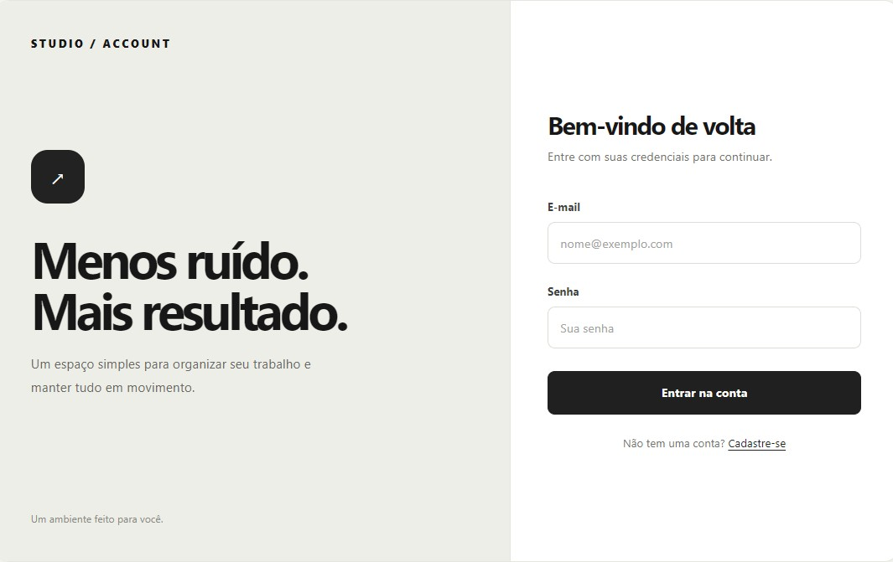
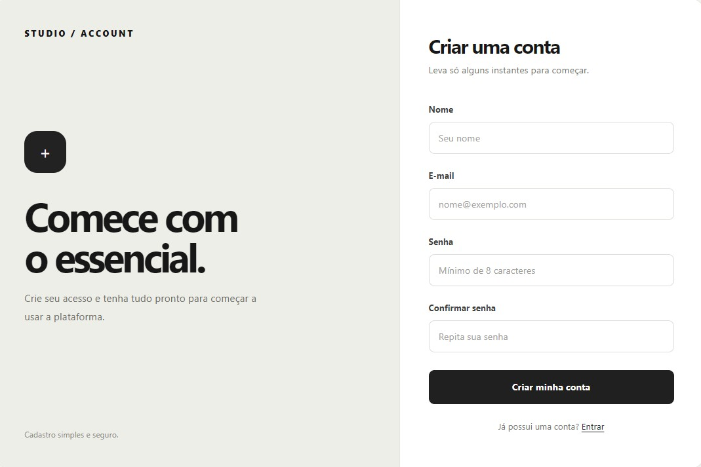
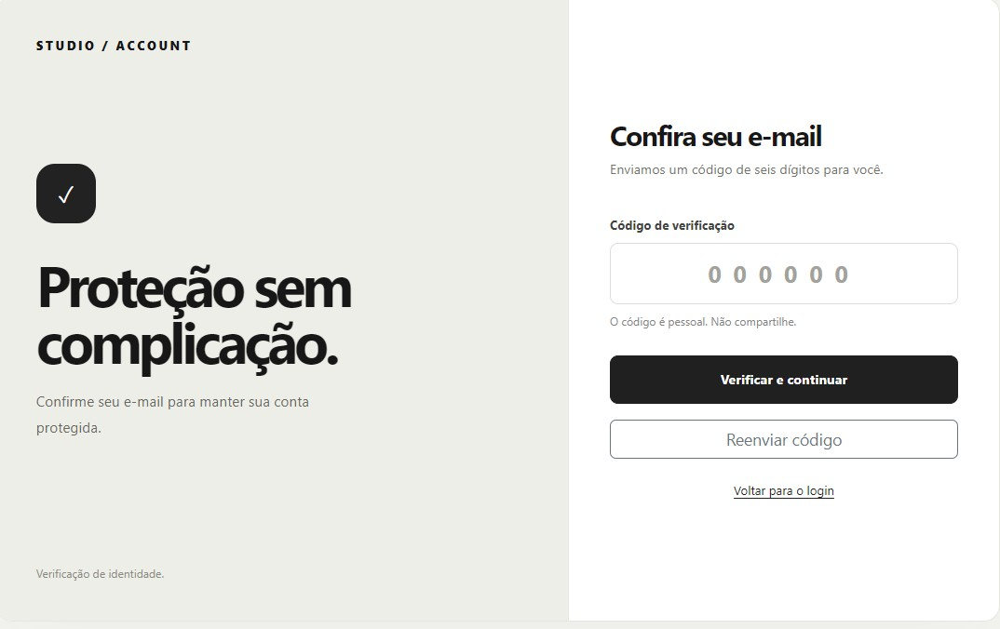
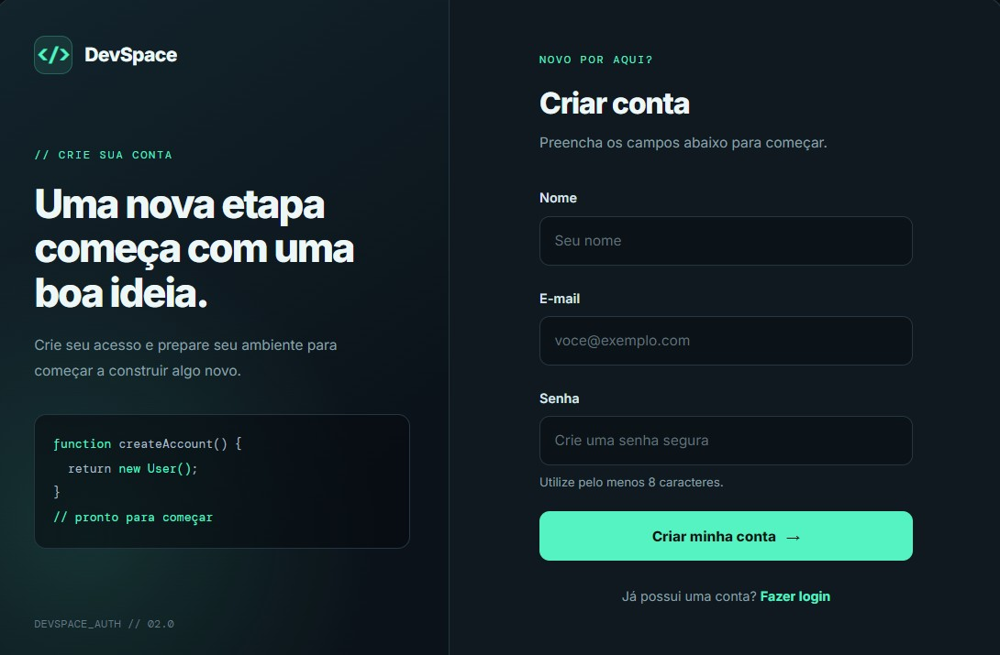

# Templates de autenticação

O projeto contém três opções de interface para autenticação. Cada template inclui telas de login, cadastro e verificação.

## Template 1

Visual escuro e minimalista, com destaque roxo. O painel apresenta uma mensagem de boas-vindas ao lado do formulário.

### Login

### Cadastro

### Verificação

## Template 2

Visual claro e limpo, com fundo neutro, cartão central e detalhes discretos.

### Login

### Cadastro

### Verificação

## Template 3

Visual escuro inspirado em ferramentas de desenvolvimento, com detalhes em verde e elementos gráficos de código.

### Login

### Cadastro

### Verificação

